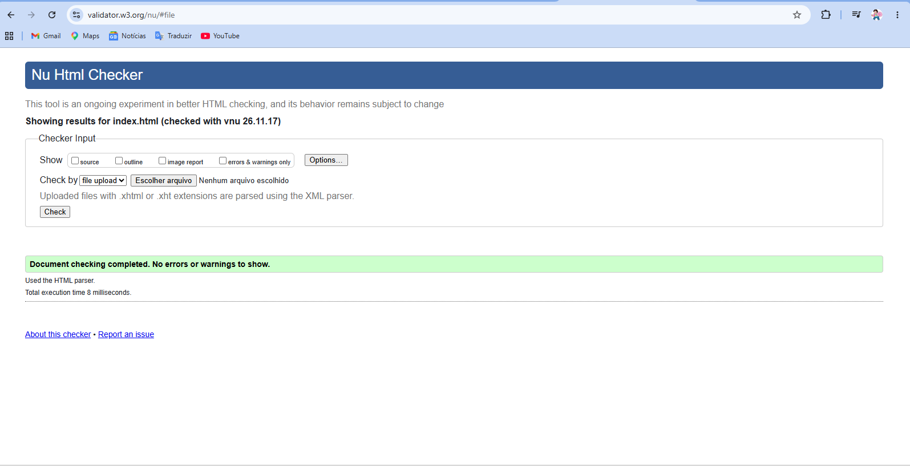
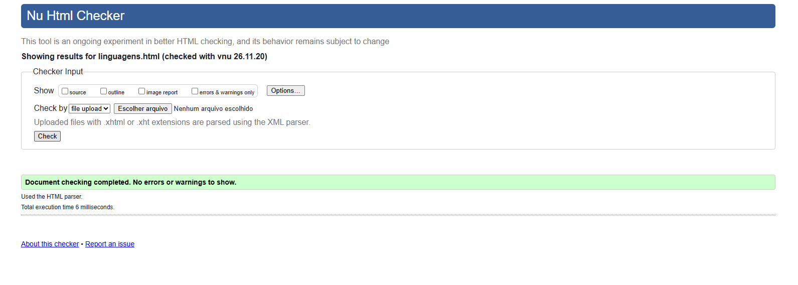
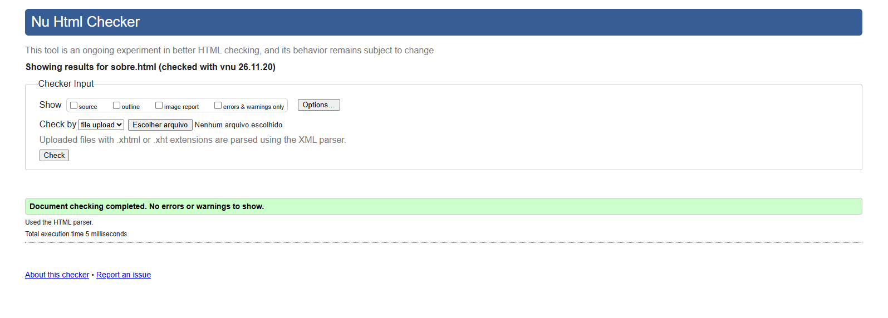
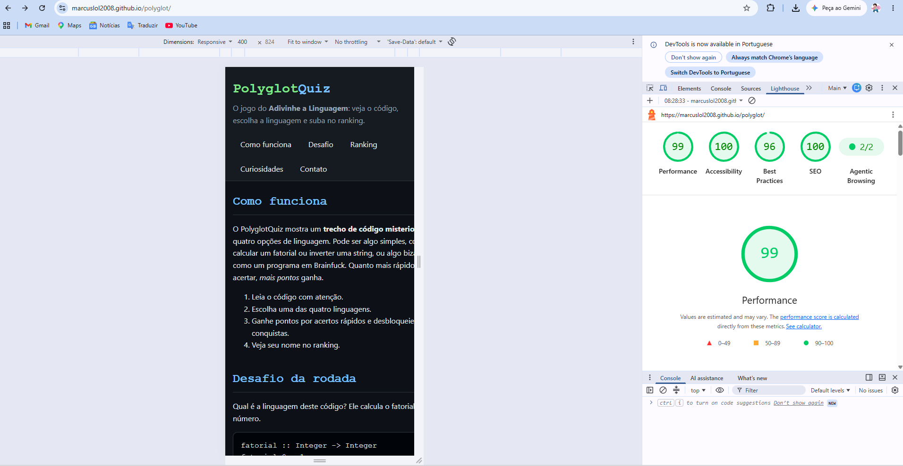
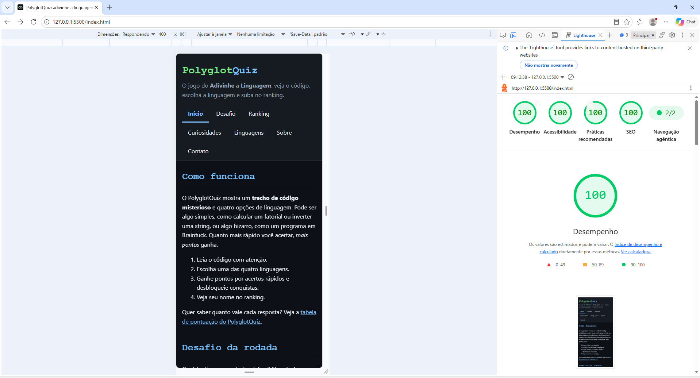

# PolyglotQuiz — O Jogo do Adivinhe a Linguagem

Projeto desenvolvido para a disciplina **Linguagem de Script para Web** (IFTM - Campus Uberaba Parque Tecnológico, 2026).

- **Tema escolhido:** quiz gamificado em que o jogador vê um trecho de código misterioso e adivinha a linguagem de programação entre 4 opções
- **Site publicado (GitHub Pages):** [https://marcuslol2008.github.io/polyglot/](https://marcuslol2008.github.io/polyglot/)

## Atividade 1 — Página Semântica

Nesta etapa foi desenvolvida a página inicial do projeto utilizando exclusivamente HTML5 semântico e CSS3 externo responsivo:

- Estrutura com landmarks (`header`, `nav`, `main`, `aside`, `footer`) e link de acessibilidade "Pular para o conteúdo".
- `lang="pt-BR"`, `meta viewport` e `title` próprio.
- Hierarquia estrita de títulos (`h1` único até `h3` sem saltos de nível).
- Três artigos em destaque (Brainfuck, Haskell e Python) utilizando `figure`, `figcaption`, atributos `alt` descritivos e dimensões (`width` e `height`).
- Tabela de ranking estruturada com `caption`, `thead`, `tbody` e `th` com `scope`.
- Formulário de contato acessível, agrupado com `fieldset`/`legend` e todos os campos associados a `label`, com tipos corretos (`text`, `email`, `url`, `select`, `textarea` e `checkbox`).
- Uso de `time`, `address`, `strong` e `em` onde fazem sentido.
- CSS externo (`css/style.css`) em abordagem mobile-first: uma coluna no celular, duas colunas em telas médias e barra lateral (`aside`) em telas grandes.

### Validação W3C

## Atividade 2 — SEO

Nesta etapa o site foi otimizado para buscadores e ganhou duas páginas novas, que também permitem testar a navegação entre páginas. Os detalhes e as medições com Lighthouse estão em [SEO.md](SEO.md).

- **Novas páginas:** [Linguagens](linguagens.html) (o mesmo código em Python, Haskell, JavaScript e Brainfuck, com as pistas de cada sintaxe) e [Sobre](sobre.html) (pontuação, conquistas e próximas etapas). O menu é o mesmo nas três páginas, e as páginas internas têm trilha de navegação.
- **`title`, `description` e `canonical`** únicos em cada página.
- **Open Graph** completo, com imagem de 1200×630 px (`images/og-cover.png`), e **favicon** em `favicon.svg`.
- **Dados estruturados (JSON-LD)** em cada página: `WebSite` no início, `CollectionPage` no guia de linguagens e `AboutPage` na página Sobre.
- **`robots.txt` e `sitemap.xml`** na raiz do projeto, com URLs absolutas.
- **Imagens, URLs e links internos:** imagens com `alt`, `width`, `height` e `loading="lazy"`, links com texto descritivo e arquivos com nomes curtos e sem parâmetros.
- **Lighthouse antes e depois:** comparação das notas da versão da Atividade 1 com a versão otimizada, em [SEO.md](SEO.md).

### Validação W3C

### Lighthouse Antes/Depois

